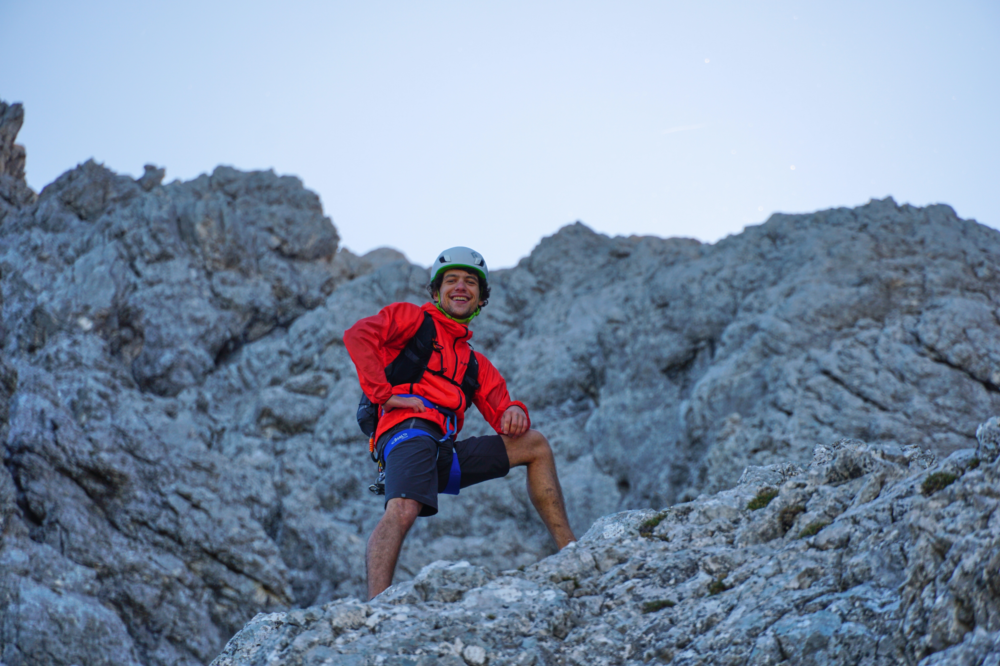

I am a mathematician, mountain enthusiast and research engineer.

- Mathematically, I am broadly interested in geometry, dynamics, probability and their interactions,

- as a mountain enthusiast, I enjoy alpinism and being outside with friends, mostly [mountaineering, climbing and ski-touring](https://mxstn.github.io/mountains);

- finally, in my current job as research engineer, I am interested in prototyping and simulations with python alongside probabilistic and geometric concepts in machine learning.

Besides that, I am a music lover; I enjoy playing guitar, attending concerts, and most recently dancing Lindy Hop :) And finally, I think it’s fair to say (with minimal bias) that "Breaking into heaven" by the Stone Roses is among the best songs ever made.

&nbsp;

# Short CV

  
2026

  
Dr. rer. nat. (~PhD) Mathematics, Technical University of Munich (TUM) 
	   <a href="https://mediatum.ub.tum.de/?id=1864092" target="_blank">"Singularities of higher codimension in fast-slow vector fields with fast gradient dynamics"</a> supervised by [Christian Kuehn](https://multiscale.systems) and [Hildeberto Jardón-Kojakhmetov](https://hildejk.xyz) 

	
  
since 2023

  
Research Engineer at <a href="https://www.medel.com" target="_blank">
	      MED-EL,</a> R&D department, Innsbruck

  
2020–2022

  
Doctoral Researcher, Technical University of Munich (TUM) 
	  as part of a <a href="https://gepris.dfg.de/project/444753754" target="_blank">DFG project on "singularities of higher-codimension in fast-slow systems"</a>
  

  
  
2020

  
MSc Mathematics, Technical University of Munich (TUM) 
	  Thesis: "Singularity theory for distributions" supervised by Christian Kuehn

  
  
2017

  
BSc Mathematics, University of Augsburg 
	  Thesis: "De-Rham cohomology of Lie groups and Lie algebras" supervised by Urs Frauenfelder

&nbsp;

# Contact

You can reach me via [5-letter-page-title][at]icloud.com

